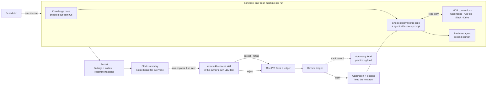

# 06 — Runtime: how the checks actually run

[05 — System](05-system.md) describes *what* the five checks look for. This page describes the machinery that runs them, tells people what they found, gets a human (and eventually an agent) to act on each finding, and learns from those decisions.

The runtime is **vendor-neutral**. Every layer is a small interface, and each one lists real tools that fit it. A reference implementation ships in this repo (`tools/runtime/`, `system/jobs/pipeline.sh`, `.github/workflows/kb-checks.yml`) and runs end to end on the example with no accounts and no API keys.

> **One worked stack.** The author's own setup is GitHub Actions (scheduler and sandbox), Supabase/Postgres (warehouse), Vercel (hosting for anything web-facing), and a mix of open-source and frontier LLMs behind one agent command. It's named below as one example per layer, not a requirement.

## The pipeline



## The layers

| # | Layer | Interface | Real-world options | In this repo |
|---|---|---|---|---|
| 1 | **Scheduler** | Start `pipeline.sh <check>` on a cadence | **GitHub Actions `schedule`**, Airflow / Dagster, Google Cloud Scheduler, AWS EventBridge, cron, a managed agent platform's scheduled runs | `.github/workflows/kb-checks.yml` |
| 2 | **Sandbox** | A fresh machine per run with the repo checked out and read-only credentials | **GitHub-hosted runner**, a Docker container, Modal, E2B, Fly Machines, a short-lived VM | the Actions runner |
| 3 | **Agent** | Any command that takes a prompt as its last argument and prints a reply (`AGENT_CMD`) | Frontier: **Claude Code** (`claude -p`), OpenAI Codex CLI (`codex exec`), Gemini CLI. Open-source: Llama, Qwen, or DeepSeek models via `llm`, Ollama, or vLLM behind an OpenAI-compatible endpoint | `system/jobs/run.sh`, `pipeline.sh` |
| 4 | **MCP connections** | Read-only access to the systems a check needs | Warehouse: **Supabase / Postgres MCP**, Snowflake, BigQuery, Redshift. GitHub MCP, Slack MCP, Google Drive MCP | scopes in `system/config.json` |
| 5 | **Report** | `system/reports/<check>.json` + `.md`, one shape for every check | n/a (plain files) | `tools/checks/common.py` |
| 6 | **Delivery** | Render one summary per check, send it somewhere | **Slack incoming webhook**; add-ons: Microsoft Teams, Discord, email, a GitHub issue | `tools/runtime/delivery.py` |
| 7 | **Review** | A conversation in which the owner decides on each finding | The **`review-kb-checks` skill** in any LLM harness: Claude Code, Cursor, Codex, ChatGPT or Claude with repo access, an open-source agent | `execution/skills/review-kb-checks/` |
| 8 | **Ledger + learning** | Append-only decisions; agreement, autonomy, calibration computed from them | plain JSONL in Git (could be mirrored to a warehouse table, e.g. Supabase) | `tools/runtime/ledger.py`, `autonomy.py` |

Each layer can be swapped without touching the others. Moving from GitHub Actions to Airflow changes layer 1 only. Switching from a frontier model to an open-source one changes one variable.

### 1. Scheduler
Decides **when**, nothing else. Schema integrity runs daily. The rest run weekly (see `system/schedule.md`). It calls `system/jobs/pipeline.sh <check>`.

### 2. Sandbox
Each run gets a **fresh, isolated machine** that is thrown away afterwards. Nothing carries over between runs except what's committed to the repo (`system/state/`, and reports if you choose to commit them).
- It checks out the knowledge-base repo.
- It receives **only the credentials this check needs**, all read-only.
- It writes only to `system/reports/`. In the reference workflow the job has `contents: read`, so it *can't* push. Reports are attached to the run as an artifact.

### 3. Agent
Inside the sandbox, an LLM agent runs the check. The prompt is `system/prompts/_shared-rules.md` + `system/prompts/<check>.md`.
- For checks 1–3, the **deterministic code** in `tools/checks/` runs first: cheap, exact, repeatable. The LLM is used only for judgment: do these two definitions *mean* the same thing? Could an agent find this quickly?
- For checks 4–5, the agent *is* the check.
- `AGENT_CMD` is the only coupling. Leave it unset and the deterministic passes still run.

### 4. MCP connections
Everything is read-only.

| Check | Warehouse | GitHub | Slack | Drive | Other |
|---|---|---|---|---|---|
| 1. Schema integrity | ✓ `information_schema` | ✓ the knowledge base | | | |
| 2. Semantic integrity | (optional: run certified SQL) | ✓ the knowledge base | | | |
| 3. Cohesion & redundancy | | ✓ the knowledge base | | | |
| 4. Proactive enrichment | | ✓ merged PRs in configured repos | ✓ configured channels | ✓ configured folders | |
| 5. Analytical gaps | ✓ query history | ✓ the knowledge base | ✓ configured channels | ✓ analysis folders | agent session logs |

For schema integrity, the sandbox **actually queries the warehouse** (one `information_schema` query, in `system/config.json`) instead of trusting the documentation. The reference workflow shows the Supabase/Postgres version as a comment and uses the example's simulated catalog.

### 5. Report
Every check produces the same structure. Each finding has:

| Field | Meaning |
|---|---|
| `id` | A **reference code** such as `SCH-3eb1e7`. It's stable: the same problem in the same place gets the same code on every run, so last week's decision still applies |
| `severity` | high · medium · low |
| `message` | What's wrong, in one sentence |
| `evidence` | Quotes, file locations, links |
| `proposed_fix` | The specific change |
| `recommended_action` | **accept** · **reject** · **refine**: what the system thinks the reviewer should do |
| `confidence` | high · medium · low: how sure it is about that recommendation |
| `basis` | Where the recommendation came from: the built-in default, the check itself, or **calibrated** from past human decisions |
| `status` | open · accepted · refined. Findings a reviewer rejected are moved to `suppressed` and don't come back |

### 6. Delivery: Slack is the notice board
When a run finishes, **one summary message per check** is posted where everyone can see it:

```
*Knowledge-base check · Schema integrity* · 2026-11-22
🔴 2 high · 🟠 2 medium · ⚪ 0 low   (4 awaiting review)
• `SCH-3eb1e7` 🔴 Documented column `analytics.fct_signup_funnel.trial_started_at` no longer exists → *accept* (medium)
• `SCH-902bfe` 🔴 `analytics.fct_nrr_monthly` is referenced in the knowledge base but no longer exists → *accept* (medium)
• `SCH-04c433` 🟠 Key table column `analytics.fct_arr_daily.plan_tier` … isn't documented anywhere → *refine* (high)
Full report: system/reports/schema-integrity.md
To act on a finding, run the `review-kb-checks` skill in your LLM tool and give it the code (or say "all open").
```

Slack is for **awareness**, not for deciding. Nobody clicks buttons in Slack. The codes are how people point at a finding later.

**Safety:** a message is posted only when the command runs with `--send` **and** `GROUNDTRUTH_SLACK_WEBHOOK_URL` is set. Otherwise it is printed. The reference workflow stays a dry run until you set the repo variable `GROUNDTRUTH_SEND=true`.

### 7. Review: a conversation, then a pull request
When the knowledge-base owner is ready, they open **their own LLM tool** and run the **`review-kb-checks` skill** (`execution/skills/review-kb-checks/SKILL.md`), giving it a code from Slack or "all open". The skill:

1. lists what's waiting, and applies anything already auto-accepted (Level 2) after one confirmation
2. takes **one finding at a time**: explains it in plain language, shows the evidence, gives both opinions (the check's and the reviewer agent's), and answers questions
3. lets the owner **accept**, **refine** ("it's `_v3`, not `_v2`"; the agent revises the fix and asks again), or **reject / ignore** (with a one-line reason, so the check learns)
4. records each decision in the ledger as it's made
5. applies the accepted fixes on a branch, runs `tools/kb.py check`, and opens **one pull request** containing the fixes *and* the ledger update, so decisions and changes merge together

| Action | What happens |
|---|---|
| **Accept** | The fix goes into the review PR |
| **Refine** | The owner says what's wrong with the proposal. The agent revises it, and the owner accepts or rejects the revision |
| **Reject** | Closed with a reason. The finding stays hidden on later runs, and the reason goes into the lessons every check reads |

Under the hood the skill calls `tools/runtime/cli.py` (`findings`, `show`, `record`, `learn`, `stats`), so the same flow works from a terminal.

### 8. The review ledger
`system/state/review-ledger.jsonl`, one line per decision:

```json
{"ts": "2026-11-22T14:05:00Z", "ref": "SCH-902bfe", "check": "schema-integrity", "kind": "missing_table",
 "where": "analytics.fct_nrr_monthly", "severity": "high", "recommended_action": "accept", "confidence": "medium",
 "reviewer_agent_action": "accept", "human_action": "accept", "decided_by": "ben", "source": "human",
 "reason": "", "refinement": "", "pr": "kb-review/2026-11-22", "minutes": 2}
```

It's append-only. **Agreement** counts only the *first* human decision on each finding, because that's the moment a person judged the system's original recommendation. A later accept after a refine is history, not a second vote.

```bash
python3 tools/runtime/cli.py stats examples/lumen
```
```
CHECK / KIND                                   VOTES  AGREE  ACC REJ REF  LVL  NOTE
cohesion-redundancy/near_duplicate                14    29%    4   0  10    0  needs 6 more decisions
schema-integrity/undocumented_column              22    91%    0   2  20    1  humans agree, but its fixes need a person to supply something (refine), so it can't auto-accept
semantic-integrity/competing_definition           12   100%    0   0  12    1  never graduates (changes a definition or certification, or needs the team's say)
semantic-integrity/unlinked_mention               24    96%   23   1   0    1  READY to take off the training wheels: add it to autonomy.auto_accept to auto-accept
```

(The example ships with eight weeks of **simulated** decisions, marked `"simulated": true`, so these commands have something to show. Delete the file to start fresh.)

## The learning loop

Every review makes the next run better, in three ways:

1. **Rejected findings stay rejected.** A finding whose latest decision is *reject* is moved to `suppressed` on every later run, so the check stops repeating itself. Record a new decision to bring it back.
2. **Lessons.** `cli.py learn` writes `system/state/review-lessons.md`: what reviewers said when they rejected or refined, grouped by kind. Every check prompt and the reviewer agent read it before reporting (`_shared-rules.md`, rule 9).
3. **Calibration.** When humans clearly and repeatedly choose a different action than the built-in default for a kind (at least 60% of at least 10 reviews), `learn` writes `system/state/calibration.json`, and the next run recommends what people actually do. In the example, reviewers keep *refining* near-duplicate merges ("keep the caveat in the finance register"), so `near_duplicate` now recommends **refine**. Its `basis` says why.

## The autonomy ladder

For each **finding kind** (for example `semantic-integrity / unlinked_mention`), the ledger measures how often the system's recommendation matched what the human did.

| Level | Who reviews | How it's reached |
|---|---|---|
| **0. Human in the loop** | A person reviews every finding | Starting point for every check |
| **1. Agent pre-review** | A **reviewer agent** (`system/prompts/reviewer.md`: separate prompt, separate context, and it doesn't see the check's recommendation) independently says accept, reject, or refine. The person sees both opinions and decides | List the check in `autonomy.reviewer_agent` in `system/config.json` |
| **2. Auto-accept: taking off the training wheels** | For that kind, findings that pass every gate below are accepted without asking. The skill applies them after one confirmation, and people spot-check | The kind is **eligible** (≥ 90% agreement over ≥ 20 reviews, counting the last 50) **and** the owner switches it on in `autonomy.auto_accept` |
| **3. Self-maintaining** | The check runs itself. People see only escalations | Every kind in the check that can graduate is at Level 2 |

**Eligible isn't on.** The system tells you when a kind has earned it. You decide when you're comfortable. If agreement later drops below the bar (the business changed in a way the check doesn't understand), the kind **drops back automatically**, even if it was switched on.

A single finding is auto-accepted only when **all** of these hold:
- its kind is at Level 2
- the check recommends **accept** with **high** confidence
- the reviewer agent independently also says **accept**
- its fix doesn't touch a definition or a certification

**Some kinds never graduate**, whatever their record: anything that changes what a metric means (`competing_definition`, `conflicting_usage`, `definition_change`, …), certifies a query, or needs the team's say (`concept_gap`, `skill_gap`). Neither does anything high severity with low confidence. A kind whose fixes usually need a person to supply something (*refine*, such as writing a column description) can be trusted but not automated. Those always go to a person.

The thresholds are suggestions, all in `system/config.json → autonomy`.

## Running it locally

```bash
cd examples/lumen
GT="python3 ../../tools/runtime/cli.py"

CATALOG=system/fixtures/catalog.json system/jobs/pipeline.sh schema-integrity   # check → reviewer → summary (dry run)
system/jobs/pipeline.sh semantic-integrity
$GT findings .                        # what's waiting, with codes
$GT show . SCH-902bfe                 # one finding, both opinions, history
$GT record . SCH-902bfe accept --by ben --minutes 2
$GT learn .                           # update calibration + lessons
$GT stats .                           # agreement per check and kind
$GT autonomy .                        # levels, and what would auto-accept now
```

Add `AGENT_CMD="claude -p"` (or any other agent command) to run the agent passes and the reviewer agent. Add `--send` plus `GROUNDTRUTH_SLACK_WEBHOOK_URL` to post for real.

## Mapping to this repo

| Layer | Where |
|---|---|
| Scheduler + sandbox | `.github/workflows/kb-checks.yml` (dry run by default) · cadences in `system/schedule.md` |
| Job entry points | `system/jobs/run.sh <check>` (one check) · `system/jobs/pipeline.sh <check>` (check → reviewer → delivery) |
| Check prompts | `system/prompts/` |
| Deterministic passes | `tools/checks/` |
| Report format | `tools/checks/common.py` (`Finding`) |
| Connections and scopes | `system/config.json` |
| Delivery | `tools/runtime/delivery.py` |
| Review skill | `execution/skills/review-kb-checks/SKILL.md` |
| Reviewer agent (Level 1) | `system/prompts/reviewer.md` · `cli.py reviewer-prompt` / `ingest-review` |
| Ledger, learning, autonomy | `system/state/review-ledger.jsonl` · `tools/runtime/ledger.py`, `autonomy.py` · `cli.py` |

**Not built yet:** checks 4–5 haven't been run against live GitHub, Slack, and Drive. Auto-accepted fixes are applied by the review skill rather than by an unattended write-enabled agent. Delivery adapters beyond Slack (Teams, email, GitHub issue) are one function each, but none are written.

Next: [07 — Adoption](07-adoption.md)
