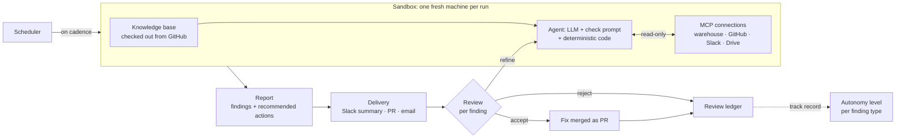

# 06 — Runtime: how the checks actually run

[05 — System](05-system.md) describes *what* the five checks look for. This page describes the machinery that runs them, delivers the results, and gets humans (and eventually agents) to act on them.

## The pipeline

Seven layers, each replaceable on its own:

### 1. Scheduler
Triggers each check on its cadence: schema integrity daily, the rest weekly (see `system/schedule.md`). Anything that can run a job on a timer works, such as GitHub Actions `schedule`, Airflow, a cloud scheduler, or a managed agent platform's scheduled runs. The scheduler only decides **when**. It passes the check name to the sandbox and does nothing else.

### 2. Sandbox
Each run gets a **fresh, isolated machine** (a container or VM) that is thrown away afterwards. Nothing carries over between runs except what's committed to the repo (`system/state/`, reports).
- It checks out the knowledge-base repo.
- It receives **only the credentials this check needs**, all read-only (see the table below).
- It can write in exactly two places: `system/reports/`, and a draft branch for proposed fixes.

Isolation keeps a misbehaving run from touching production data, and means every run starts from the same clean state.

### 3. Agent
Inside the sandbox, an LLM agent runs the check. The prompt is `system/prompts/_shared-rules.md` + `system/prompts/<check>.md`.
- For checks 1–3, the agent first runs the **deterministic code** in `tools/checks/`, which is cheap, exact, and repeatable. It then uses the LLM only for what needs judgment: do these two definitions *mean* the same thing, and could an agent find this quickly?
- For checks 4–5, the agent *is* the check. It reads signals and decides what matters.

### 4. MCP connections
What each check needs to reach. Everything is read-only.

| Check | Warehouse | GitHub | Slack | Drive | Other |
|---|---|---|---|---|---|
| 1. Schema integrity | ✓ `information_schema` | ✓ the knowledge base | | | |
| 2. Semantic integrity | (optional: run certified SQL) | ✓ the knowledge base | | | |
| 3. Cohesion & redundancy | | ✓ the knowledge base | | | |
| 4. Proactive enrichment | | ✓ merged PRs in configured repos | ✓ configured channels | ✓ configured folders | |
| 5. Analytical gaps | ✓ query history | ✓ the knowledge base | ✓ configured channels | ✓ analysis folders | agent session logs |

For schema integrity, the sandbox **actually queries the warehouse** to confirm that every table and column the knowledge base references is live. It doesn't trust the documentation.

### 5. Report
Every check produces the same structure (`system/reports/<check>.json` for machines, `.md` for people). Each finding has:

| Field | Meaning |
|---|---|
| `severity` | high · medium · low |
| `message` | What's wrong, in one sentence |
| `evidence` | Quotes, file locations, links |
| `proposed_fix` | The specific change |
| `recommended_action` | **accept** · **reject** · **refine**: what the system thinks the reviewer should do |
| `confidence` | high · medium · low: how sure the system is about that recommendation |

### 6. Delivery
When a run finishes, a **summary message per check** goes to a Slack channel: counts by severity, the top findings, and a link to the full report and the draft PR. Slack is the default. The same report can also go to email, a GitHub issue or PR, or a ticketing tool. Delivery is a thin adapter, so adding a destination doesn't touch the checks.

### 7. Review: accept, reject, refine
In the human-in-the-loop phase, a reviewer acts on **every finding**:

| Action | What happens |
|---|---|
| **Accept** | The proposed fix is applied on the draft branch and merged as a PR (gated by `tools/kb.py check`) |
| **Reject** | The finding is closed with a short reason. The reason is stored, so the check stops repeating it and learns what isn't a problem |
| **Refine** | The reviewer says what's wrong with the proposal ("it's renamed to `_v3`, not `_v2`", "add this as a caveat, not a new metric"). The agent revises the fix and re-proposes it |

Every decision is recorded in a **review ledger** (`system/state/review-ledger.jsonl`): check, finding type, the system's recommendation, the human's action, and the time taken.

## The autonomy ladder

The review ledger is how the system earns autonomy. For each **finding type** (for example `schema-integrity / undocumented_column`), it measures how often the system's recommendation matched what the human did.

| Level | Who reviews | Graduation rule (suggested) |
|---|---|---|
| **0. Human in the loop** | A person reviews every finding | Starting point for every check |
| **1. Agent pre-review** | A *reviewer agent* (separate prompt, separate context) independently recommends accept, reject, or refine. The person sees both opinions and confirms | Turn on once a check has run a few weeks |
| **2. Auto-accept** | For that finding type, high-confidence recommendations that both agents agree on are applied automatically. People spot-check a sample | ≥ 95% agreement with humans over ≥ 30 findings of that type |
| **3. Self-maintaining** | The system runs itself. People see only escalations | Remaining types meet the Level 2 bar |

Some things **never graduate**: changing a metric's definition, certifying a query, and anything marked high severity with low confidence. Those always go to the artifact's owner.

If a type's agreement rate drops (because the business changed in a way the check doesn't understand), it automatically drops back a level.

## Mapping to this repo

| Layer | Where |
|---|---|
| Scheduler | `system/schedule.md` (cadences + GitHub Actions example) |
| Sandbox entry point | `system/jobs/run.sh <check>` |
| Agent instructions | `system/prompts/` |
| Deterministic passes | `tools/checks/` |
| Report format | `tools/checks/common.py` (`Finding`) |
| Connections and scopes | `system/config.json` |
| Delivery, review ledger, reviewer agent | *Not built yet.* Designed here; the next step is a reference implementation |

Next: [07 — Adoption](07-adoption.md)
